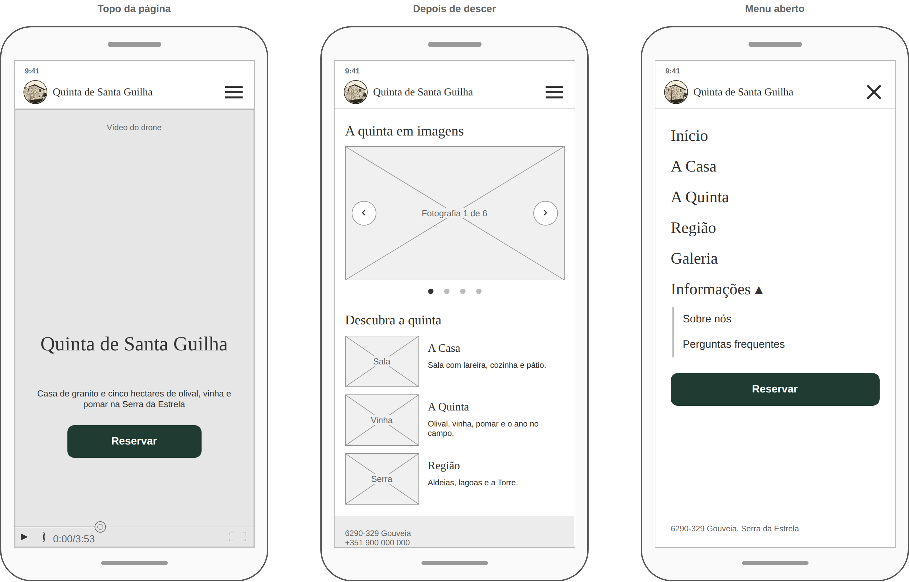
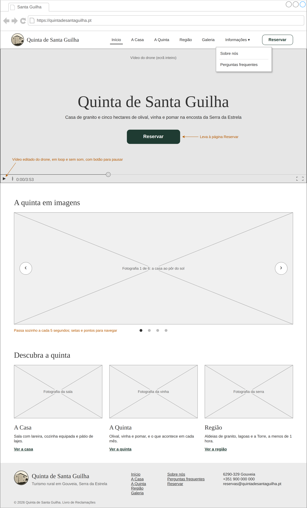
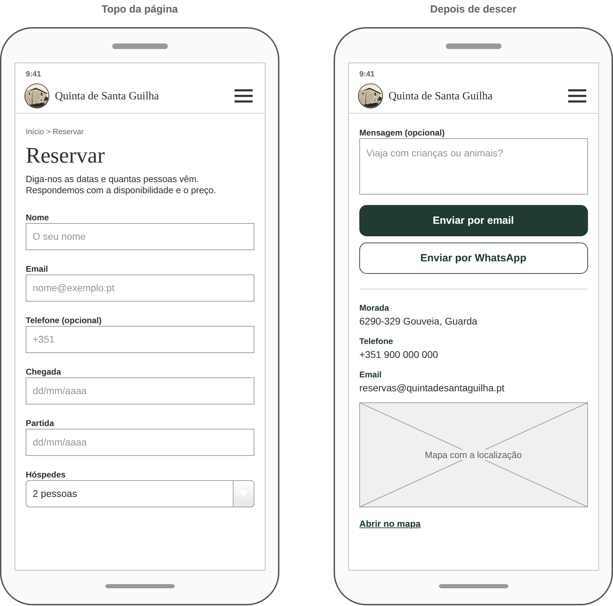
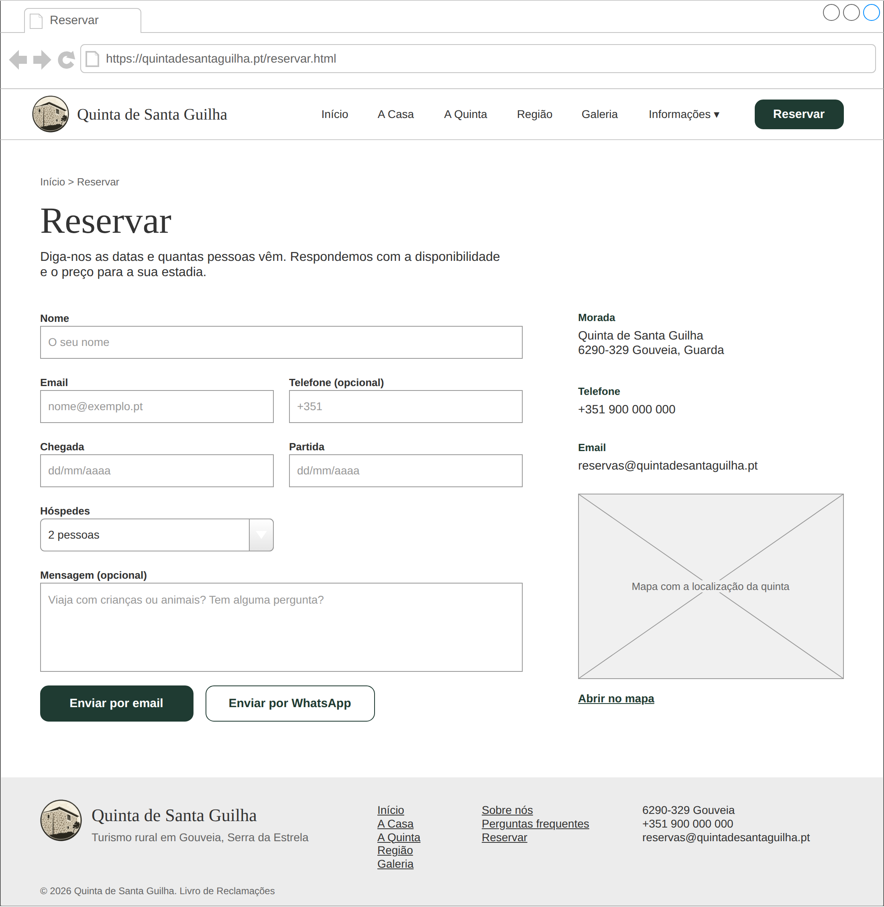

# Quinta de Santa Guilha

Website de turismo rural da Quinta de Santa Guilha, em Gouveia (Serra da Estrela).

Projeto da unidade curricular **Desenvolvimento para a Web**, da Licenciatura em Ciência de Dados para a Gestão (Coimbra Business School | ISCAC), ano letivo 2026/2027.

## Grupo

- André Filipe Souza Kingwell a2024134754
- João Filipe Loureiro da Silva a2024134076

## O projeto

A Quinta de Santa Guilha é uma casa tradicional de granito com cinco hectares de olival, vinha, pomar e nogueiral, na encosta da Serra da Estrela.

O website serve para dar a conhecer a quinta: mostrar a casa, a região e as atividades de cada época do ano. Os visitantes podem pedir uma reserva diretamente, sem depender de plataformas como o Booking ou o Airbnb, e quem reserva pode inscrever-se nas atividades.

## Estrutura do website

O website tem nove páginas. Seis estão no menu principal, ao lado do botão Reservar; Sobre nós e Perguntas frequentes ficam dentro do item Informações.

```
Menu: Início | A Casa | A Quinta | O ano na quinta | Região | Galeria | Informações | Reservar

Início ......................... apresentação da quinta e destaques das páginas
├── A Casa ..................... espaços, comodidades e fotografias da casa
├── A Quinta ................... olival, vinha, pomar e nogueiral
├── O ano na quinta ............ gráfico dos meses e atividades por época
├── Região ..................... lugares a visitar e tempos de viagem
├── Galeria .................... fotografias da casa, da quinta e da região
├── Informações
│   ├── Sobre nós .............. história da casa e da família Loureiro
│   └── Perguntas frequentes ... reservas, estadia, atividades e como chegar
└── Reservar ................... pedido de reserva e contactos
```

## Funcionalidades

### Básicas

- Menu de navegação com o submenu Informações; no telemóvel e no tablet ocupa o ecrã inteiro
- Design responsivo para telemóvel, tablet e computador
- Página inicial com vídeo de drone ou imagem da quinta e slideshow de fotografias
- Páginas da casa, da quinta, da região e Sobre nós
- Página "O ano na quinta" com gráfico das horas de luz e do trabalho de cada mês
- Atividades por época do ano (apanha da uva, pisa das uvas, apanha da azeitona), filtradas ao escolher um mês no gráfico
- Inscrição nas atividades para quem tem reserva na quinta
- Pacotes extra pagos à parte: Serra com neve, visita guiada à Serra da Estrela, prova de vinhos e visita à queijaria
- Galeria em que cada fotografia abre em tamanho grande para mostrar os detalhes
- Perguntas frequentes organizadas por categorias
- Formulário de pedido de reserva com validação básica; integração dos dados com email e WhatsApp prevista para uma entrega seguinte
- Contactos e mapa

### Extras

Os seguintes extras estão previstos, mas ainda não fazem parte desta entrega:

- Calendário de disponibilidade com as datas já ocupadas
- Estimativa do preço da estadia
- Mapa interativo com os lugares a visitar na região
- Formulário que guarda no website os dados das reservas e das inscrições

## Estado do projeto

### Implementado nesta entrega

- Nove páginas em português, com navegação entre elas
- Layout responsivo para telemóvel, tablet e computador
- Vídeo de drone e slideshow na página inicial
- Galeria com fotografias em tamanho grande
- Gráfico anual com filtro de atividades por mês
- Formulário de reserva com validação HTML e opções de atividades conforme o mês, preenchido a partir da data de chegada
- Contactos, mapa e perguntas frequentes

### Planeado

Os extras listados acima e as funcionalidades descritas em [Próximos passos](#próximos-passos) ainda não estão implementados.

## Esquemas

Os esquemas foram feitos no [draw.io](https://app.diagrams.net) com a biblioteca de formas Mockups. O ficheiro original está em [`docs/mockups/quinta_santa_guilha.drawio`](docs/mockups/quinta_santa_guilha.drawio) e tem quatro separadores: a página inicial e a página Reservar, cada uma em telemóvel e em computador. Na mesma pasta está a exportação em PNG de cada separador.

Para abrir o ficheiro: em app.diagrams.net, escolher Ficheiro › Abrir de › Dispositivo.

No telemóvel, a página inicial aparece em três ecrãs (o topo, a parte seguinte e o menu aberto) e a página Reservar em dois. As notas a laranja explicam o que fazem alguns elementos.

### Página inicial · Mobile



### Página inicial · Desktop



### Reservar · Mobile



### Reservar · Desktop



## Código

O site é feito em HTML e CSS, com design responsivo para telemóvel, tablet e computador. O slideshow, o filtro por mês e o formulário de reserva usam três ficheiros pequenos de JavaScript.

### Tecnologias

- **HTML5** — estrutura e conteúdo das páginas.
- **CSS3** — estilos, layout responsivo, menu do telemóvel e perguntas frequentes.
- **JavaScript** — slideshow, filtro por mês e formulário de reserva, sem bibliotecas externas.
- **Backend e base de dados** — não são usados nesta versão.

### Requisitos

- Um navegador moderno.
- A pasta completa do projeto, extraída do ZIP.

Não é necessário instalar dependências, Node.js ou npm.

Para ver o site, extraia o ZIP completo para uma pasta e abra `index.html` no navegador. Pode fazê-lo com duplo clique ou arrastando o ficheiro para uma janela do navegador. Não abra o ficheiro a partir da pré-visualização do ZIP: os restantes ficheiros do site podem não estar acessíveis.

Se preferir usar o terminal, entre primeiro na pasta extraída. O comando depende do sistema operativo:

**Windows (PowerShell):**

```powershell
Start-Process .\index.html
```

**Linux:**

```bash
xdg-open ./index.html
```

O JavaScript corre no próprio navegador; o site não precisa de servidor, `localhost`, Node.js ou npm.

### Pedido de reserva

Nesta entrega, os campos do formulário têm validação HTML. O botão de email usa `mailto:`, que depende do programa de correio configurado no computador de quem visita o site; o site não confirma a entrega da mensagem. O botão de WhatsApp aponta para um número provisório, abre apenas uma conversa e ainda não inclui os dados preenchidos no formulário.

Numa entrega seguinte, pretendemos usar JavaScript para ler as datas, o número de hóspedes, as atividades e os pacotes selecionados e preparar a mesma mensagem de reserva para email ou WhatsApp. A pessoa poderá rever e enviar essa mensagem na aplicação escolhida. Para enviar ou guardar reservas automaticamente, sem essa confirmação, será necessário um serviço ou servidor próprio.

```
quinta_santa_guilha/
├── index.html                 Início
├── casa.html                  A Casa
├── quinta.html                A Quinta
├── ano-na-quinta.html         O ano na quinta
├── regiao.html                Região
├── galeria.html               Galeria
├── sobre-nos.html             Sobre nós
├── perguntas-frequentes.html  Perguntas frequentes
├── reservar.html              Reservar
├── css/
│   ├── base.css               cores, letra, botões e secções comuns
│   ├── menu.css               cabeçalho e menu
│   ├── rodape.css             rodapé
│   └── (um ficheiro por página)
├── js/
│   ├── slides.js              slideshow da página inicial
│   ├── ano-na-quinta.js       filtro por mês de O ano na quinta
│   └── reservar.js            atividades e pacotes do formulário de reserva
├── fonts/
├── images/
└── videos/                    vídeos de drone da página inicial e de A Quinta
```

Os elementos interativos feitos com JavaScript:

- Slideshow da página inicial: setas que trocam a fotografia, a legenda e o número (`js/slides.js`)
- Filtro por mês em O ano na quinta: cada atividade indica os seus meses em `data-meses` e o script esconde as que não são do mês escolhido (`js/ano-na-quinta.js`)
- Atividades do formulário de reserva conforme o mês escolhido (preenchido a partir da data de chegada; só se podem escolher os meses da estadia) e detalhes de cada pacote extra; os campos escondidos ficam desativados e não vão no pedido, e a data de partida tem de ser depois da chegada (`js/reservar.js`)

Os elementos interativos feitos só com HTML e CSS:

- Menu do telemóvel em ecrã inteiro: caixa de seleção escondida e o seletor `:checked`
- Submenu Informações e respostas das perguntas frequentes: elemento `<details>`
- Fotografias da galeria: cada miniatura é uma ligação para a fotografia grande
- Janela de cada atividade (só texto) e de cada pacote extra (com fotografia e descrição): seletor `:target`
- Validação do formulário de reserva: atributos `required`, `type="email"` e `pattern`

## Próximos passos

Numa fase seguinte, o projeto acrescenta mais JavaScript ao site que já existe, sem mudar a estrutura das páginas:

- **Tempo na quinta e na serra:** mostrar a temperatura atual na quinta e na Torre, na Serra da Estrela, usando dados do [Open-Meteo](https://open-meteo.com/), que não requer chave de API.
- **Tempos de viagem de carro:** apresentar na página Região o tempo de carro entre a quinta e cada lugar, calculado com o OSRM (OpenStreetMap).
- **Como chegar de Coimbra, Lisboa e Porto:** permitir escolher a cidade de partida e o meio de transporte (carro, comboio ou autocarro), mostrando um tempo aproximado e o percurso no Google Maps. Como não há uma API aberta com os horários da CP e da Rede Expressos, os horários atualizados serão consultados no Google Maps.
- **Pedido de reserva por email ou WhatsApp:** preparar uma mensagem com as datas, o número de hóspedes, as atividades e os pacotes escolhidos, para a pessoa rever e enviar na aplicação escolhida.

Mais tarde, poderão ser desenvolvidos os extras listados acima. O calendário de disponibilidade, o cálculo do preço e o armazenamento das reservas vão precisar de um serviço ou servidor próprio.

## Referências

Websites que serviram de referência e o que se aproveitou de cada um.

| Website | O que se aproveitou |
|---|---|
| [São Lourenço do Barrocal](https://barrocal.pt/) | Vídeo em ecrã inteiro na abertura da página inicial. A página de atividades, em que cada atividade tem fotografia, título e uma frase, e o calendário de eventos ao longo do ano deram a ideia para "O ano na quinta". |
| [Craveiral Farmhouse](https://www.craveiral.pt/) | Abertura da página inicial com uma imagem grande e botão Reservar destacado no topo. |
| [Quinta da Estrela](https://quintadaestrela.com/pt-pt/) | Website de uma quinta de turismo rural da mesma região, a Serra da Estrela. |
